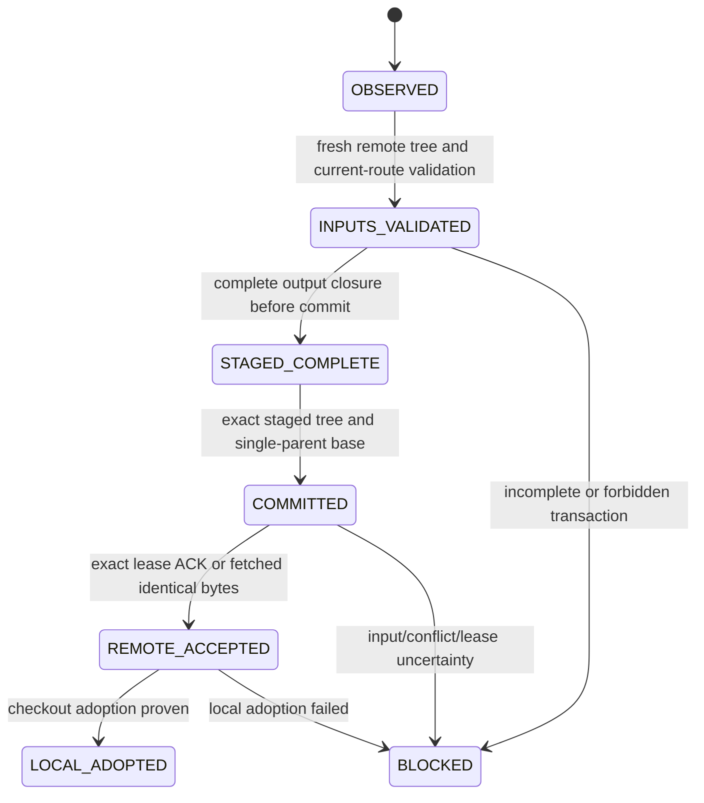

# Phase 1.5 operational recovery hardening (Issue #20)

This implementation starts at `main@6bb5cb46a8477f2d7edf0310980791c2fb140415`.
The earlier `recovery-stale-state-design.md` remains a historical DESIGN ONLY
proposal. Issue #20 separately authorizes the operational implementation here.
Nothing here authorizes historical signal regeneration or a new model phase.

## Exact-base re-inventory and tests-first evidence

`recovery-topology.json`, reproducible with
`python -B tests/engineering/recovery_topology.py`, inventories eleven lanes at
the exact base: primary, backup, observation recovery, Daily Command Center,
E2 morning, E2 postclose, macro cache, display, EOD, review and health. It records
source/workflow hashes, schedules/triggers, write sets, immutable subsets, read
contracts, legal windows, validators, closure, retry and manual semantics.
Historical/research utilities remain inventory-only; they are not executed.
The existing 29-writer/31-publication-exit inventory is retained unchanged.

The first implementation commits contain inventory, then synthetic tests, before
behavior changes. Three pinned-base characterization tests demonstrate actual
gaps: publication of incomplete Q017 closure, publication of incomplete E2
closure, and absence of a durable fence after accepted remote publication with
failed local adoption. These tests deliberately retain and execute the old
publisher in disposable local remotes; passing means the old gap was reproduced,
not that old behavior is safe. The twenty-scenario suite was introduced before
its recovery module existed. It is a safety specification, not a claim that all
twenty scenarios were unsafe at the base.

Additional red tests reproduced self-test writing a global observation alias,
existing-decision recomputation, missing post-ingest readiness admission and
status/mother-receipt hash disagreement. Each was fixed at the I/O boundary.
No scoring function was changed.

## Architecture and evidence

`scripts/hengce_recovery_transaction.py` provides admission, local fences,
producer-specific closure validators and evidence. It never pushes, fetches
market data, dispatches workflows, ranks or repairs a producer artifact.
`scripts/hengce_publish.py` remains the only publication implementation, with
the existing profiles, immutable rules and exact main leases. It calls the
transaction hooks around its existing publication/adoption operations.



Every phase may stop; it cannot fabricate missing intermediate phases. The
manifest records workflow/run/attempt, lane/date, original base, input Git blob
identities, proposal write identities, immutable subset, accepted remote SHA,
local adoption, reason codes and evidence completeness. Unproven acceptance or
adoption is UNKNOWN. Git blob identities include mode/type/hash. Inputs start
conservative; the publisher records the selected profile's proven exclusions.

The active fence is atomic JSON under the checkout's Git directory
(`hengce-recovery/active.json`), outside producer data. Unique transition records
and rejection diagnostics go under `$RUNNER_TEMP/hengce-publication/transactions`.
Existing always-upload steps retain them along with publication receipts and
captured proposal evidence. New recovery manifests, diagnostics, publication
receipts and Q017 recovery/backup receipts have all four required fields:

```json
{"signal_authority":false,"ranking_authority":false,"capital_authority_twd":0,"broker_order_execution":false}
```

Before computing, admission requires a clean checkout and fetches main. Clean
data-only advancement can be adopted before computation. Code/workflow/config
drift requires review. Computation is fenced after a committed/unresolved intent
or accepted-but-unadopted publication. A failed read-tree/update-ref never revokes
remote acceptance. A fresh checkout matching fetched remote bytes plus input
validation is required to resume. A retained old manifest additionally requires
its proposal bytes to match remote. Reconciliation evidence is explicitly new
evidence; it does not invent a lost ACK. Destroyed runners rely on the remote
canonical artifacts and new validation, rather than an absent local manifest.

Staging checks the allowed lane write set, immutable conflicts, dirty/untracked
input/output, exact output closure and generation timestamps. Publication checks
the exact staged tree and original parent again, then validates the fetched
remote and candidate trees. Independent authoritative input drift blocks even
when proposal output bytes already match. Health-only advancement remains
unrelated where the existing profile proves it. Overlapping mutable conflicts
STOP; immutable bytes cannot be replaced; identical valid state is
IDEMPOTENT_NOOP. ACK loss triggers bounded fetch/revalidation, never blind rebase.
No global capture lock or second publication implementation is introduced.

## Per-lane rules

| Lane | Recovery boundary |
| --- | --- |
| Q017 primary / backup | Separate original capture concurrency groups. Capture requires the original 09:01 evidence window. Missing evidence after 09:02 STOPs before provider invocation. Canonical/alias/history and backup status hashes must agree. |
| Q017 recovery | Current date only. Primary canonical wins; otherwise only a valid immutable backup can be copied. No blending, refetch or post-window reconstruction. Existing validated decision returns directly without reranking. Missing history/ledger or conflicting immutable evidence requires reconciliation, not backfill. |
| Daily Command Center | Same original modes and producer commands. Admission and scoped fences surround existing operations. Q017 source failure does not confer authority or poison independent E2 computation; unresolved publication/adoption fences the whole checkout. Daily does not itself produce unified display; its existing downstream display workflow remains separate. |
| E2 morning / postclose | Original engine, position and no-fill code unchanged. State/override bindings must validate. New state/morning/display or state/history/display closure is checked as appropriate. Recovery generation cannot be backdated. Future-effective overrides retain the original effective-date semantics. |
| Macro cache | Same original premarket window. Dated/latest/history cache hashes and SOX/DXY CSV bindings must agree; no causal-session extension. |
| Display | Same renderer and source semantics. Regenerated display must bind to existing E2 state and formal Q017 evidence. It cannot make stale source fresh. |
| EOD | Original source schemas/minimums unchanged. Dates, unique keys, row counts, exact shard list/hash, leg receipts, status and mother receipt bindings validate before downstream readiness and publication. Missing/partial evidence cannot become COMPLETE. Valid source PENDING remains PENDING_DATA; valid price + mother still permits the original no-wait-margin downstream behavior. |
| Reviews | No repeated dates, torn history or incompatible immutable cohort changes. Ledger/report/daily-summary lineage must agree. Historical cohort seeding/backfill is BLOCKED. |
| Health | Diagnostic only; unchanged four-axis evaluator/collector and isolated publication. No recovery dispatch, producer writes or recovery computation dependency. |

Manual dispatch preserves existing self-test defaults. Explicit operational
routes are permitted only for the already-authorized current date and window.
Historical/future dates, unknown contracts and model/authority requests STOP.
The Q017 recovery self-test now confines all observation paths to its temporary
directory. It does not write the global observation_latest alias.

## Offline fault scenarios and merge gates

`test_recovery_faults.py` has twenty numbered scenarios, with multiple subcases:

1. Kill between canonical, alias, history and ledger writes.
2. Truncated immutable canonical.
3. Computed output without commit.
4. Committed output without push; later computation fenced.
5. Accepted push with lost ACK, fetched as identical NOOP.
6. Accepted remote plus untracked local adoption collision.
7. Kill between index and HEAD adoption; fresh clean recovery admission.
8. Latest missing canonical, and inverse.
9. Canonical missing history/ledger: no invented repair.
10. Identical retry NOOP; incompatible retry STOP.
11. Independent primary/backup races, duplicate recovery and existing decision wins.
12. Health-only advancement remains safe.
13. Macro/history/universe/code/override/state input drift blocks stale output.
14. Closed-window missing/invalid evidence cannot refetch, rebuild or blend.
15. Partial E2 state/morning/history/display rejected, including precommit gate.
16. Partial EOD shards/receipts/mother mismatch; price+mother with margin PENDING preserved.
17. Repeated review dates, torn history, immutable timestamp collision.
18. Current/self-test versus historical/future requests; self-test I/O isolation.
19. Late E2 remains LATE_RECOVERY after display/health regeneration.
20. Unknown manifest fields/states and nonzero authority rejected.

All fixtures are synthetic, use injected time and disposable local remotes, and
deny network sockets. No live provider or production outcome is a test input.
Integration tests pin model functions, original E2/EOD/review source bytes,
schedule/trigger/group/job settings, existing publisher use, precommit guards,
post-publication fences and the health boundary. Existing writer/health/static
non-interference tests remain required. Engineering Replay must finish as a
successful workflow with eleven IDENTICAL checks; its eight existing producer
regressions and STOP-on-difference self-test remain unchanged. CI run IDs and
final-head results are recorded in the PR after completion, not predeclared here.

## Limitations and explicitly blocked work

This is not universal exactly-once execution. The Git-dir fence is local to a
checkout; immutable remote artifacts and fetched-byte validation carry authority
across destroyed runners. Actions artifact retention follows repository policy,
not a permanent external audit store. Missing first-publication lineage remains
UNKNOWN. Local artifacts with incomplete closure are retained for diagnosis and
blocked; there is no automatic repair, reset, stash or historical reconstruction.

Mother authority remains the existing original-vessel receipt contract. This
change verifies receipt/leg/status bindings; it does not establish a new external
mother, change source authority or prove an external file unavailable to this
checkout. Historical/research writer utilities remain inventory-only and do not
receive authorization from these operational lane contracts. External writers
outside the inventoried workflows are not claimed to be transaction-aware.
New lanes/source contracts require explicit inventory and validator re-audit.

Date admission uses Taipei time and weekdays, not an authoritative holiday
calendar. Original producer/source availability gates remain applicable. Manual
holiday or unavailable-source requests may STOP/PENDING; no synthetic session
is created. Strict closure can expose pre-existing incomplete state that needs
human reconciliation, including review historical seeds or missing EOD receipts.

BLOCKED subtasks: historical-date recovery, historical cohort/signal/ledger
backfill, invalid immutable replacement, unclear input provenance, and any
model/authority change. No optimizer/backtest/tuning, sealed holdout, Phase 2,
broker execution or promotion is implemented. Q017/E2/M1 formulas, weights,
thresholds, ranking, universe/capital authority and separation remain locked.
M1 stays RESEARCH_SHADOW_ONLY / capital 0; B01–B09 stay PARTIAL; B10 stays
BLOCKED_PENDING_EXPLICIT_HUMAN_AUTHORIZATION; PROMOTE_TO_PRODUCTION is FORBIDDEN.
Actual user trades are not used as model evidence. Human review is required;
this PR must not merge automatically.
